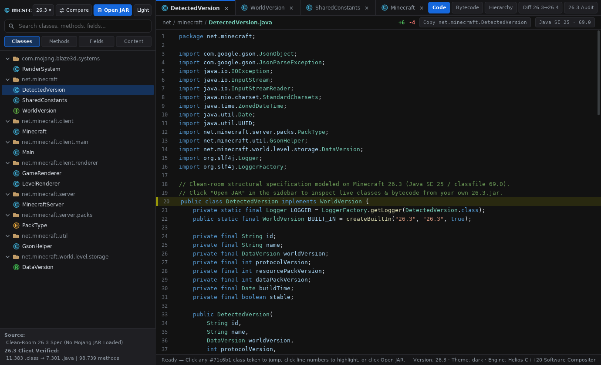

# minecc — Native C++20 `mcsrc.dev`-Style Code Explorer, Custom HTML5+CSS3+ES6 Compiler & Clean-Room Inspector

> **NOT AN OFFICIAL MINECRAFT PRODUCT. NOT APPROVED BY OR ASSOCIATED WITH MOJANG OR MICROSOFT.**
>
> `minecc` contains **zero** Minecraft source code, **zero** binaries (`.jar`/`.class`), **zero** mappings, and **zero** game assets. All inspection caches and decompiled `.java` files stay strictly local on your machine inside git-ignored `.local/` from **your own licensed copy** of *Minecraft: Java Edition*. See [`NOTICE.md`](NOTICE.md) and the [Minecraft EULA](https://www.minecraft.net/en-us/eula).



---

## Native C++20 Engine (`HeliosUI`), Custom Compiler (`minecc-uic`) & Cross-Platform Binaries

**Zero WebView2 · Zero Chromium · Zero Electron · Zero Node · Zero External DLLs.**
The entire desktop application UI (`ui/mcsrc.html`, `ui/mcsrc.css`, `ui/mcsrc.js`) is compiled by our custom **`minecc-uic`** compiler into a binary UI bundle (`bin/mcsrc.muib`) and rendered natively in **~8–11 ms per 1380×840 frame** by our scratch C++20 engine (`native/include/helios/`):

| Native Binary (`bin/`) | Platform / ABI | Size | What It Does |
| --- | --- | --: | --- |
| **`bin/minecc-studio-windows-x86_64.exe`** | **Windows x64 GUI (`PE32+`)** | **1.08 MiB** | Standalone Win32 + DWM dark-titlebar `StretchDIBits` desktop IDE modeled on `mcsrc.dev/2/26.3/net/minecraft/DetectedVersion` |
| **`bin/minecc-studio-linux-x86_64`** | **Linux x64 (`ELF64`, glibc 2.28+)** | **1.04 MiB** | Standalone Linux native X11 desktop IDE, headless PNG rasterizer (`--render-png`), & live remote server (`--serve`) |
| **`bin/minecc-uic-windows-x86_64.exe`** | **Windows x64 CLI (`PE32+`)** | **597 KiB** | Custom HTML5 + CSS3 + ES6 static compiler, `.muib` bundler & instant standalone `.exe` packager (`--pack-exe`) |
| **`bin/minecc-uic-linux-x86_64`** | **Linux x64 CLI (`ELF64`, glibc 2.28+)** | **540 KiB** | Custom HTML5 + CSS3 + ES6 static compiler, `.muib` bundler & instant standalone Linux ELF packager (`--pack-exe`) |

### Native Engine Subsystems (`native/include/helios/`)

1. **`html_dom.hpp` — Spec-Modeled HTML5 Tokenizer & Live DOM Tree:** Parses raw HTML5 documents and dynamic `innerHTML` fragments, resolves HTML character entities, maintains mutable live `DomNode` trees, and supports `getElementById`, `setAttribute`, `classList`, `dataset`, `closest()`, and W3C bubbling DOM events.
2. **`css_engine.hpp` — W3C CSS3 Cascade, Custom Properties & Flexbox Layout:** Parses descendant/child combinators (` `, `>`), `#id`, `.class`, `[attr="val"]`, `:root`, `:hover`, `:active`, `:focus`, computes exact `(important, inline, id, class, tag, order)` specificity, cascades `var(--*)` custom properties (`#121212` dark / `#ffffff` light), and runs W3C CSS Flexible Box layout (`flex-grow`/`shrink`/`basis`, `gap`, `justify-content`, `align-items`, `overflow: auto` scroll containers).
3. **`js_vm.hpp` — Custom ES6 Lexer, Recursive-Descent AST Parser & Closure Interpreter:** Full lexical scoping, closures, arrow functions, template literals, objects/arrays, loops, and live `document` / `Host` native bindings.
4. **`painter.hpp` — Pure CPU 32-bpp ARGB Software Rasterizer:** Anti-aliased SDF rounded rectangles, borders, soft shadows, IntelliJ vector symbol icons (`C`/`I`/`E`/`R`/folder/chevrons), FreeType2-baked DejaVu Sans & DejaVu Sans Mono glyphs (`native/generated/font_atlas.hpp`), and zero-dependency PNG output.
5. **`jvm_reader.hpp` — Pure C++20 RFC 1951 Deflate + ZIP/JAR Reader + JVMS `0xCAFEBABE` (`69.0` / Java SE 25) Disassembler:** Opens your local `26.3.jar` directly in C++ without requiring Java or `zlib1.dll`, reconstructing Java class signatures and full JVM opcode listings on the fly.

### Native Usage & Compiling Your Own HTML+CSS+JS Native Apps

```bash
# Run the native mcsrc-style IDE on Windows (double-click or pass your local 26.3.jar):
.\bin\minecc-studio-windows-x86_64.exe
.\bin\minecc-studio-windows-x86_64.exe --jar "%APPDATA%\.minecraft\versions\26.3\26.3.jar"

# Run natively on Linux desktop (X11), render a PNG screenshot, or serve live interactive framebuffer:
./bin/minecc-studio-linux-x86_64
./bin/minecc-studio-linux-x86_64 --render-png preview.png
./bin/minecc-studio-linux-x86_64 --serve 0.0.0.0:8765

# Compile ANY custom (.html + .css + .js) app into a standalone Windows .exe or Linux binary in <10 ms:
./bin/minecc-uic-linux-x86_64 my_ui.html --pack-exe ./bin/minecc-studio-windows-x86_64.exe my_app.exe
./bin/minecc-uic-linux-x86_64 my_ui.html --pack-exe ./bin/minecc-studio-linux-x86_64 ./my_app

# Rebuild all 4 Linux + Windows x86_64 executables from C++20 source:
python3 scripts/build_native.py
```

---

## Verified Reference Facts: Latest Minecraft Java Edition (October 2026)

Starting with **Java Edition `26.1`** (March 24, 2026 — after `1.21.11`, the final `1.x` and final ProGuard-obfuscated release), Mojang switched to `year.drop[.hotfix]` versioning and **stopped obfuscating `client.jar` and `server.jar`**. Class names (`net.minecraft.*`, `com.mojang.*`), method names, field names, and local variable tables ship unobfuscated directly in the Java 25 (`classfile 69.0`) bytecode.

### Current Official Builds

| Build | Type | Release Date | Java Required | `client.jar` Size | `client.jar` SHA-1 |
| --- | --- | --- | --- | --- | --- |
| **`26.3`** (*Wilderness Bound*) | Latest Stable Release | `2026-09-15` | **Java SE 25** (`69.0`) | ~53 MiB | `e877b6a07acd633fb3bb475002175cec036e7b87` |
| **`26.4-snapshot-5`** | Latest Snapshot | `2026-10-20` | **Java SE 25** (`69.0`) | ~76 MiB | `dabe2b9759859995565e7d01c4a96d05043718ee` |
| **`1.21.11`** (*Mounts of Mayhem*) | Final `1.x` (Obfuscated) | `2025-12-09` | **Java SE 21** (`65.0`) | — | Requires ProGuard/Mojmap remapping |

### Verified `26.3` Codebase Metrics (`Vineflower 1.12.0` + `OpenJDK 25`)

Audited against checksum-verified official `26.3` artifacts (`research-lock.json`):

| Artifact (`26.3`) | Compiled `.class` Files | Compiled Methods | Expected `.java` Files | Emitted `.java` Files | Failed Markers |
| --- | --: | --: | --: | --: | --: |
| **`client.jar`** (`e877b6a0...`) | **11,383** | **98,739** | **7,301** | **7,301** | **0** |
| **`server.jar` inner JAR** (`META-INF/versions/26.3/server-26.3.jar`) | **7,762** | **72,269** | **5,037** | **5,037** | **0** |

- **Why `11,383` `.class` files become `7,301` `.java` files:** Nested classes, enums, records, and anonymous classes (`Foo$Bar.class`) share their enclosing compilation unit (`Foo.java`) via JVM `SourceFile` attributes.
- **Why client + server counts must not be added together:** Shared gameplay, worldgen, entity, registry, and protocol packages (`net.minecraft.world.*`, `net.minecraft.network.*`, `com.mojang.datafixers.*`, etc.) are compiled into both JARs; `client.jar` adds `net.minecraft.client.*` and `com.mojang.blaze3d.*`, while `server.jar` adds dedicated-server classes.
- **Lines of Code (LOC):** Full client decompiled `.java` text totals **~29.1 MB+** across the `7,301` files (**~750,000–850,000 total lines** depending on decompiler formatting options; published 1:1 `26.3` parity benchmarks measure **~786k lines**). Run `minecc decompile` or `minecc source-stats` locally to print exact total, SLOC, comment, and blank line counts per package on your machine.

---

## Why Clean-Room Generators Survive on GitHub (While Source Uploads Get DMCA'd)

Long-standing public repositories such as **`Hexeption/MCP-Reborn`** (created 2019 — a **69 KB** source archive with zero game files), **`hube12/DecompilerMC`** (created 2019 — pure Python scripts), **`PaperMC/Paper`** (patch diffs only), **`FabricMC/mcsrc`** (client-side WASM Vineflower in your browser), **`ArrowMeo2088/MinecraftSourcesGenerator`**, and **`ludovic111/horizon`** all stay compliant on GitHub for one exact reason:

- **They contain `0` bytes of Minecraft code or assets in Git.** Every one of them runs locally against the user's own copy and keeps generated `.java` trees git-ignored.
- Conversely, repositories that commit Mojang's decompiled `.java` files, `.jar` binaries, archives, or encoded payloads violate the [Minecraft EULA](https://www.minecraft.net/en-us/eula) regardless of disclaimers or archiving notices, and are routinely removed under public `github/dmca` filings.

---

## Quick Start (On Your Own Machine)

### Prerequisites
1. **Python 3.10+** (zero third-party pip packages required).
2. A legally purchased copy of **Minecraft: Java Edition `26.3`** installed and launched at least once in the official Minecraft Launcher (`~/.minecraft`, `%APPDATA%\.minecraft`, or `~/Library/Application Support/minecraft`).
3. **OpenJDK 25** (for running `Vineflower 1.12.0` to emit `.java` files; pure bytecode inspection via `minecc inspect` works without Java installed).

### Commands

```bash
# 1. Enable the pre-commit guardrail hook (blocks staging .jar/.class/Mojang packages)
git config core.hooksPath .githooks

# 2. View pinned SHA-1/SHA-256 locks and audited 26.3 reference counts
PYTHONPATH=src python3 -m minecc locks

# 3. Inspect your local 26.3 client.jar bytecode & javac line spans in ~2 seconds (no JDK needed)
PYTHONPATH=src python3 -m minecc inspect --version 26.3

# 4. Decompile your local 26.3 client.jar into git-ignored .local/minecraft/26.3/sources/
#    and compute exact SLOC / total lines / subsystem breakdowns
PYTHONPATH=src python3 -m minecc decompile --version 26.3 --accept-eula

# 5. Re-run exact SLOC / comment / blank line stats on any local .java folder
PYTHONPATH=src python3 -m minecc source-stats .local/minecraft/26.3/sources

# 6. Verify the Git working tree & index contain zero proprietary files
PYTHONPATH=src python3 -m minecc check-tree
```

---

## Repository Structure

```text
minecc/
├── .github/workflows/ci.yml   # Runs unit tests + `minecc check-tree` on every push/PR
├── .githooks/pre-commit       # Rejects commits containing .jar, .class, net/minecraft/, etc.
├── .gitignore                 # Ignores .local/, work/, sources/, *.jar, *.class, eula.txt
├── LICENSE                    # MIT License (applies solely to minecc's clean-room code)
├── NOTICE.md                  # Legal & trademark notice
├── pyproject.toml             # Zero-dependency Python >=3.10 package configuration
├── research-lock.json         # Pinned SHA-1/SHA-256 hashes & audited 26.3 metrics
├── src/minecc/
│   ├── classfile.py           # Pure-Python JVMS §4 binary .class parser (up to Java 25 v69.0)
│   ├── jar_inspector.py       # Launcher discovery, SHA-1 lock verification, bundler unwrapper
│   ├── decompiler.py          # Local EULA check + pinned Vineflower 1.12.0 runner into .local/
│   ├── source_stats.py        # Lexical Java SLOC / comment / blank / failure-marker analyzer
│   ├── tree_guard.py          # Git public-tree audit preventing proprietary file leaks
│   └── cli.py                 # Command-line interface
└── tests/
    └── test_minecc.py         # End-to-end unit tests on synthetic JVM bytecode & guardrails
```
