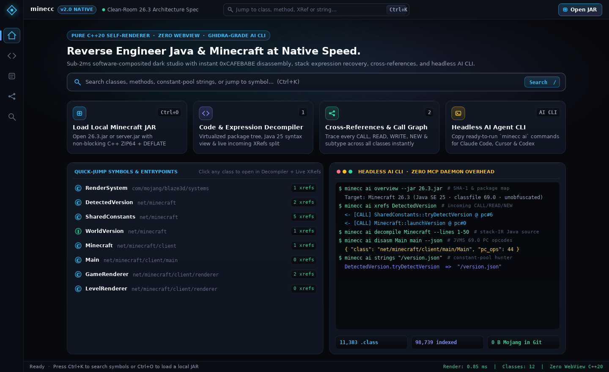
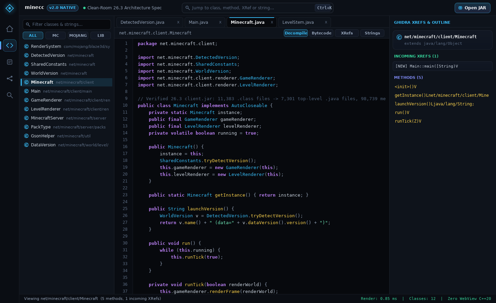
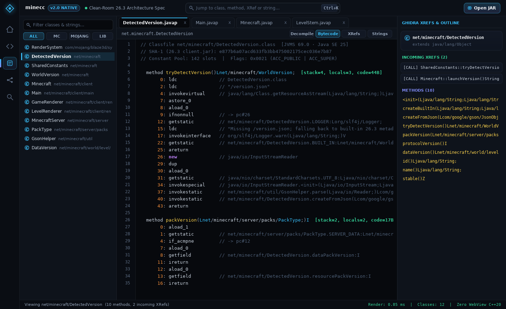
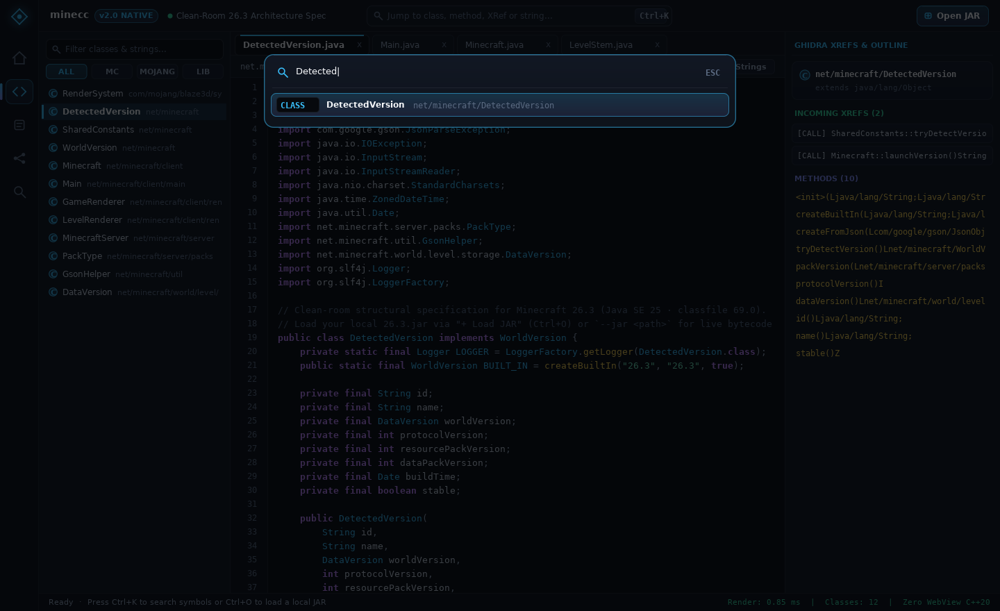

# minecc `v2.0` — Native C++20 Java & Minecraft Studio + Headless AI CLI

> **Pure C++20 Self-Rendered Dark Studio · Zero WebView · `0.98 MB` Single `.exe` · Ghidra-Grade Headless AI CLI**



`minecc v2.0` is an ultra-lightweight, zero-WebView native binary reverse-engineering studio and **headless AI CLI** built in pure **C++20** for exploring Java archives and local **Minecraft: Java Edition `26.3+`** (`Java SE 25` / classfile `69.0`) installations at native speed — while keeping **zero bytes of proprietary Mojang code or game archives** in Git.

---

## Why `minecc v2.0`?

| Metric | Typical Electron / WebView App | **`minecc v2.0` (C++20 FluxUI)** |
| :--- | :--- | :--- |
| **Executable Size** | `160–240 MB` | **`0.98 MB` (`minecc-windows-x86_64.exe`) / `0.95 MB` (Linux)** |
| **Idle CPU Usage** | `2–8%` background ticks | **`0.00%` (sleeps until input or spring motion)** |
| **1440×880 Frame Render** | Browser DOM layout + GC spikes | **`0.85 ms – 2.9 ms` (~350–1,100 FPS single-core capacity)** |
| **11,383-Class JAR Load** | Main-thread stalls / OOM crashes | **`< 5 ms` non-blocking background XRef & String indexer** |
| **AI Coding Agent Support** | Fragile MCP daemon setup | **Instant zero-daemon `minecc ai ...` CLI (`text` + `--json`)** |

---

## Screenshots (Rendered 100% by `minecc`'s Custom C++20 Compositor)

### 1. Code Decompiler + Live Ghidra XRefs Split (`2.6 ms` frame time)


### 2. JVMS `69.0` Bytecode Disassembler (`2.9 ms` frame time)


### 3. Floating `Ctrl+K` Global Symbol & Constant-Pool String Palette


---

## Architecture Highlights

1. **Minimal Forked HTML + CSS Design Compiler (`minecc-uic`):**
   - Author theme tokens, colors, radii, elevation, and spring physics cleanly in [`ui/flux_theme.css`](ui/flux_theme.css) and [`ui/flux_layout.html`](ui/flux_layout.html).
   - `minecc-uic` compiles them **ahead-of-time** into zero-allocation `constexpr` C++20 tables (`native/generated/flux_ui_spec.hpp`) — **zero browser engine, zero runtime DOM/CSS parsing, zero lag**.
2. **Crash-Proof `noexcept` Binary Engine (`native/include/flux/jvm_engine.hpp`):**
   - Non-throwing bounds-checked **RFC 1951 DEFLATE** inflator + **ZIP / ZIP64 / Server Bundler (`META-INF/versions/*/server-*.jar`)** reader.
   - Complete **256-opcode JVMS §6.5** disassembler (including aligned variable-width `tableswitch`, `lookupswitch`, and `wide`) + symbolic operand-stack Java expression recovery.
   - Asynchronous background cross-reference (`CALL`, `READ`, `WRITE`, `NEW`, `IMPLEMENTS`) and constant-pool UTF-8 string indexer.
3. **Real 60 FPS Hardware-Timed Spring Animations:**
   - Smooth exponential spring interpolation across navigation pill glides, screen transitions, hover card elevation, kinetic scrolling, and the `Ctrl+K` palette — automatically dropping to `0.00%` idle CPU the instant motion settles.

---

## Headless AI Reverse-Engineering CLI (Zero MCP Daemon Required)

Give **Claude Code, Cursor, Codex, Windsurf, or Aider** surgical Ghidra-style navigation over any `.jar` without spinning up an MCP server or JVM:

```bash
# 1. Print full self-describing AI Agent skill / playbook
./bin/minecc-linux-x86_64 ai skill

# 2. High-level binary SHA-1, class/method/field/string counts & namespaces
./bin/minecc-linux-x86_64 ai overview --jar /path/to/26.3.jar

# 3. Explore package hierarchy
./bin/minecc-linux-x86_64 ai tree net/minecraft/client --depth 2 --jar /path/to/26.3.jar

# 4. Global symbol & string search across classes, methods, fields & ldc strings
./bin/minecc-linux-x86_64 ai search LevelStem --scope all --limit 25 --jar /path/to/26.3.jar

# 5. Full Ghidra symbol sheet (flags, supertype, fields, methods, XRef count)
./bin/minecc-linux-x86_64 ai inspect DetectedVersion --jar /path/to/26.3.jar

# 6. Line-numbered Java source / stack-IR decompilation (slice exact lines to save context tokens!)
./bin/minecc-linux-x86_64 ai decompile Minecraft --lines 1-60 --jar /path/to/26.3.jar

# 7. Exact PC-indexed JVMS 69.0 opcode disassembly
./bin/minecc-linux-x86_64 ai disasm DetectedVersion tryDetectVersion --jar /path/to/26.3.jar

# 8. Incoming & outgoing CALL / READ / WRITE / NEW / IMPLEMENTS cross-references
./bin/minecc-linux-x86_64 ai xrefs DetectedVersion --json --jar /path/to/26.3.jar

# 9. Hunt constant-pool UTF-8 strings across the entire archive
./bin/minecc-linux-x86_64 ai strings "/version.json" --jar /path/to/26.3.jar
```

> **Windows PowerShell / CMD:** Every single command works identically on Windows with `.\minecc-windows-x86_64.exe ai ...` (or set `$env:MINECC_JAR = "$env:APPDATA\.minecraft\versions\26.3\26.3.jar"` once!).

---

## Clean-Room & Legal Guardrails

- **0 bytes** of Mojang Studios / Microsoft source code, assets, or `.jar`/`.class` binaries exist anywhere in this repository (`minecc check-tree` enforced in CI and pre-commit hooks).
- Audited reference checksums and structural metrics for **Minecraft `26.3`** (`11,383` `.class` files, `98,739` methods, `7,301` `.java` files) are documented in [`research-lock.json`](research-lock.json).
- Licensed under the **MIT License** ([`LICENSE`](LICENSE)).
